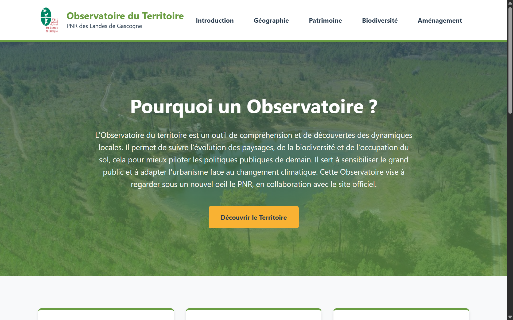

# Observatoire du territoire : PNR des Landes de Gascogne

Site web d'observatoire du Parc naturel régional des Landes de Gascogne, réalisé dans le cadre du Master 1 Observation de la Terre et Géomatique (Université de Strasbourg).

**Site en ligne : [https://louishmboc.github.io/observatoire-pnr-landes-gascogne/](https://louishmboc.github.io/observatoire-pnr-landes-gascogne/)**



## Objectif

L'observatoire est un outil de compréhension des dynamiques locales du territoire. Il rassemble des indicateurs, des cartes interactives et des textes de présentation pour :

- suivre l'évolution des paysages, de la biodiversité et de l'occupation du sol ;
- éclairer les politiques publiques et l'aménagement face au changement climatique ;
- sensibiliser le grand public à la richesse du Parc.

## Contenu

Le site comporte cinq pages thématiques.

| Page | Contenu |
| --- | --- |
| Introduction | Présentation de l'observatoire, quatre objectifs, carte web du Parc |
| Géographie | Chiffres clés (superficie, population, altitude, La Leyre), répartition de l'occupation du sol, tableau de bord démographique |
| Patrimoine | Châteaux et patrimoine bâti du Parc, StoryMap interactif « MapTour » |
| Biodiversité | Lagunes, sites Natura 2000, indicateurs sur les espèces, tableau de bord hydrographie et zones humides |
| Aménagement | Services et voies de randonnée du Parc, tableau de bord interactif |

### Cartographie intégrée

- 3 tableaux de bord ArcGIS Dashboards (démographie ; hydrographie et zones humides ; services et randonnées)
- 1 carte web ArcGIS intégrée par le composant `arcgis-embedded-map`
- 1 StoryMap ArcGIS sur les châteaux du Parc

### Indicateurs présentés

- Superficie du Parc : 315 300 ha, pour 212 400 habitants
- Altitude : de 0 à 171 m, moyenne d'environ 67 m
- Occupation du sol : forêt 78 %, agricole 15 %, urbanisé 4 %, milieux ouverts et humides 3 %
- Biodiversité : plus de 4 000 espèces observées, environ 1 000 lagunes, 6 sites Natura 2000

## Technologies

- HTML5, CSS3 (variables CSS, grille et flexbox, charte graphique aux couleurs du Parc)
- JavaScript (gestion du lien actif dans la navigation)
- ArcGIS Online : Dashboards, StoryMaps, carte web
- Hébergement : GitHub Pages

## Structure du dépôt

```
docs/
├── index.html          Introduction
├── geographie.html     Portrait géographique
├── patrimoine.html     Patrimoine culturel et paysages
├── biodiversite.html   Biodiversité et nature
├── amenagement.html    Aménagement du territoire
├── style.css           Feuille de style commune
├── script.js           Navigation
├── landes.jpg          Logo
└── fond-pnr.jpg        Image d'en-tête
```

## Lancer le site en local

```
git clone https://github.com/louishmboc/observatoire-pnr-landes-gascogne
cd observatoire-pnr-landes-gascogne/docs
python -m http.server 8000
```

Puis ouvrir `http://localhost:8000`. Ouvrir directement `index.html` dans le navigateur fonctionne aussi.

## Publication

Le site est publié avec GitHub Pages.

## Sources des données

- IGN
- INSEE
- OpenStreetMap (OSM)
- Parc naturel régional des Landes de Gascogne

## Pistes d'amélioration

- Mettre à jour automatiquement les chiffres clés, aujourd'hui saisis dans les pages, à partir des sources ouvertes
- Ajouter une page de suivi de l'évolution de l'occupation du sol dans le temps
- Ajouter des tests d'accessibilité et une version adaptée aux petits écrans

## Auteur

Louis Bocquet, Master 1 Observation de la Terre et Géomatique, Université de Strasbourg, 2026.
Le projet a été réalisé seul.

## Licence

Le logo du PNR et les photographies du projets sont la propriété du PNR Landes de Gascogne.